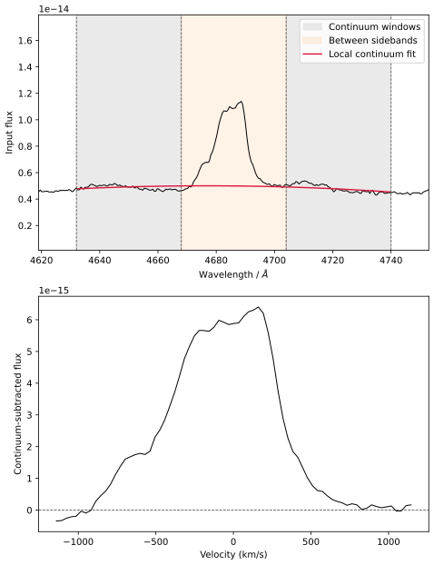
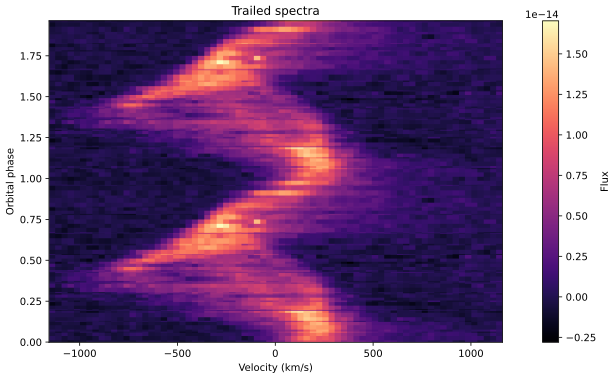
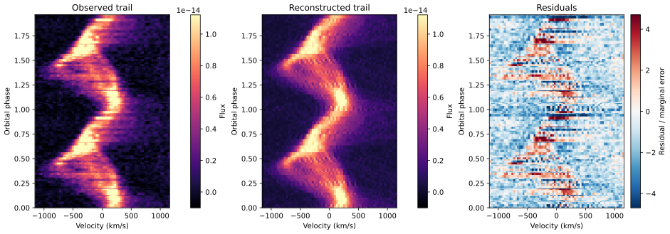
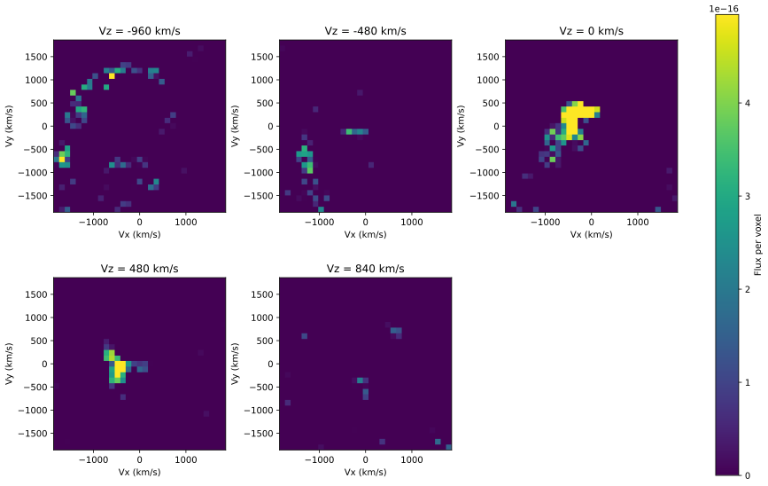
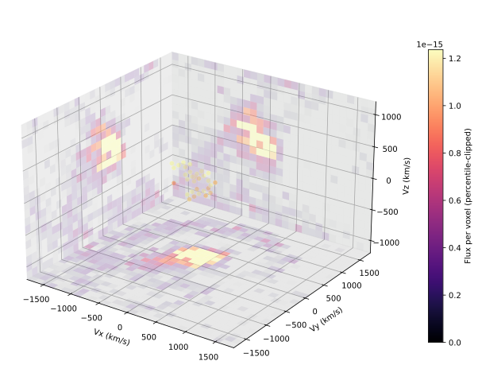

# Exploratory V834 Cen example

These figures were regenerated with version 0.2, signed observations and full
propagated covariance, on a 31 x 31 x 21 grid at inclination 50 degrees. The
200-iteration-budget run reports **default_not_converged**, with mean chi-square
per retained constraint approximately **2.648**. This is a partial demonstration,
not an accepted physical reconstruction. In particular, do not identify its
vertical structures with unique measured flows.

[Complete settings, diagnostics, and hashes](readme_images/provenance.json).
Run `python sample_script.py --allow-incomplete` to regenerate the products.

## Preprocessing and observations

## Prediction and residuals

Observed and reconstructed panels use the same physical numerical units and
color scale. Residuals are divided by marginal standard deviations; they are
not whitened and remain correlated.

## Map views

Slices show true velocity coordinates and actual selected grid centers. The
3D view emphasizes bright voxels and is intended for exploration only.

